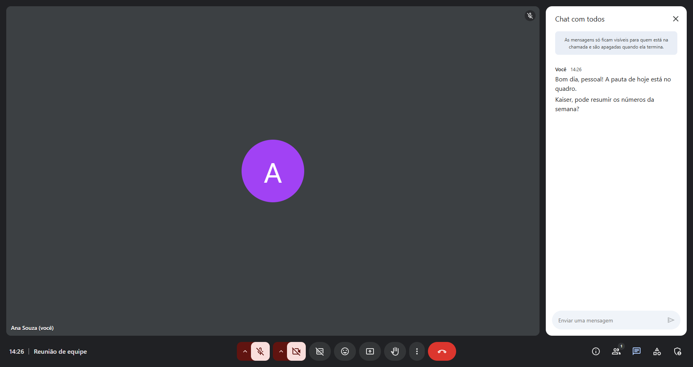
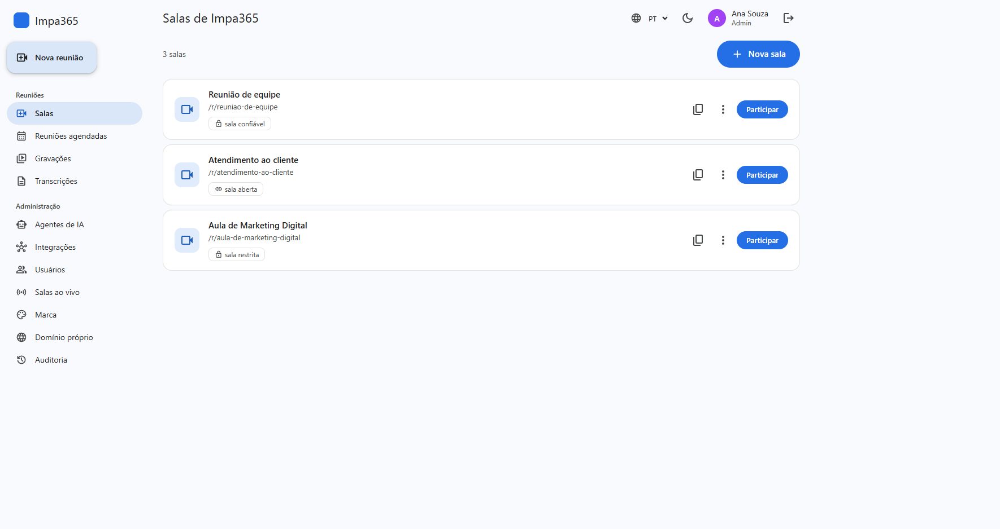
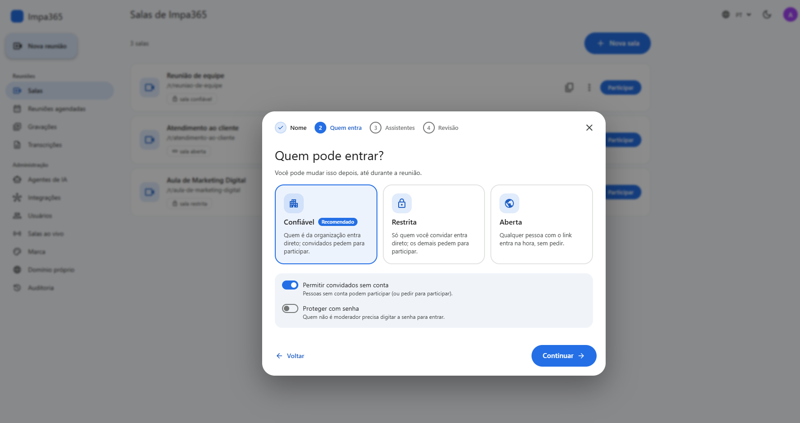
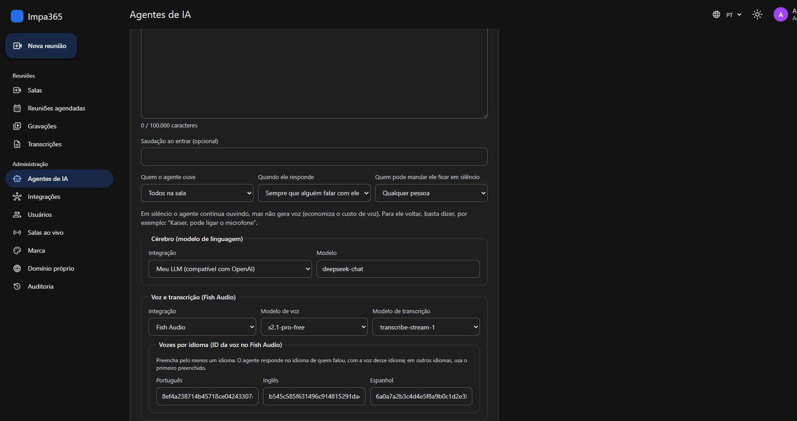
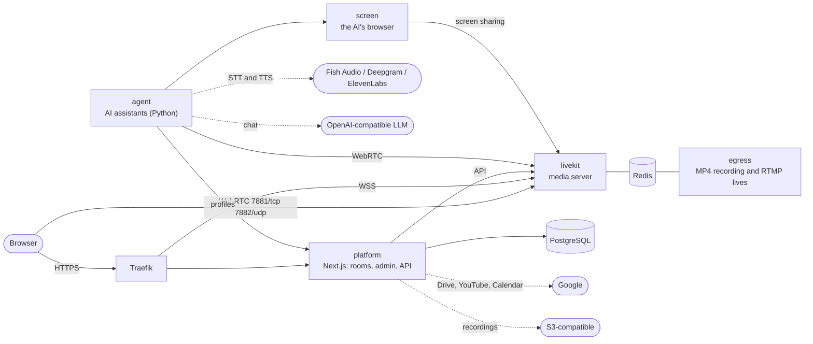

<div align="center">

# IMPA Meet

**White-label video conferencing with AI assistants that listen, talk and present.**
Open source, self-hosted, ready for Docker Swarm and Portainer.

[](LICENSE)
[](https://hub.docker.com/r/impa365/impameet-platform)
[](https://hub.docker.com/r/impa365/impameet-platform)


[Features](#features) ·
[Install](#install-in-10-minutes) ·
[Architecture](#architecture) ·
[Development](#development) ·
[Support the project](#support-the-project)

[Português](README.md) · **English** · [Español](README.es.md)



</div>

---

**IMPA Meet** is a complete video meeting platform you install on your own server and ship
under your own brand. What sets it apart are its **voice AI assistants**: they join the call as
participants, answer when called by name, reply in the speaker's language, hand the floor to
each other and can even share their screen to present web pages.

Created and maintained by **[Impa 365](https://impa365.com)**: intelligent AI automation for
businesses.

## Features

### Meetings
- **Google Meet**-style interface: grid and spotlight, active speaker, control bar and side
  panels.
- Green room with camera and microphone test, **background blur and virtual backgrounds**, and
  screen sharing.
- Chat, reactions, hand raise, **live captions** and saved transcripts.
- **MP4 recording** (LiveKit Egress), collaborative **whiteboard** (Excalidraw), **polls** and
  **breakout rooms**.
- **Moderation**: the organizer promotes moderators during the meeting (mute, remove, meeting
  controls).
- Scheduling with e-mail invitations, calendar files (`.ics`) and **Google Calendar**: each
  person connects their own calendar, the meeting goes there with the link and Google invites
  the guests.

### Studio and live streaming
- **StreamYard-style studio**: stage and backstage, bring people on and off stage, layouts
  (one person, grid, spotlight, screen + people, full screen), screen sharing on stage, name
  tags, **banners** (bar or scrolling ticker) and your brand (colours and logo).
- **Live streaming** to **YouTube** (by connecting the account: the live is created by itself,
  no key to copy) and to **any RTMP server** (Facebook, Instagram, Twitch, LinkedIn...), with
  **up to 5 destinations at once**.
- A studio's recording and live stream look exactly like the stage.

### Recordings in the cloud
- Recordings go by themselves to **S3 or compatible** storage (Amazon S3, Cloudflare R2,
  Wasabi, Backblaze B2, MinIO) or to a **Google Drive** folder, with or without a copy on the
  server.

### AI assistants
- Up to **4 assistants per room**, each with its own persona, knowledge base and voice. With
  more than one in the room, each answers when called by name and hands over to the next.
- **Any OpenAI-compatible LLM** (OpenAI, DeepSeek, OpenRouter, Groq, local models...) and, to
  listen and speak, **Fish Audio**, **Deepgram** or **ElevenLabs**, all in real time over
  WebSocket. Speech-to-text and text-to-speech are chosen separately, in any combination (for
  example Deepgram listening and ElevenLabs speaking).
- **One voice per language**: the assistant answers in Portuguese, English or Spanish,
  following whoever spoke.
- Listens to everyone or only to whoever calls it, goes quiet on request and **shares a
  screen** through its own browser, with an animated cursor.
- No default provider, model or voice on the server: everything is chosen in the panel, and
  keys are encrypted.

### Access control
- **Open**, **trusted** or **restricted** rooms, with an invite list.
- **Waiting room**: a moderator admits whoever asks to join.
- Optional password, guests without an account and per-room permissions (who draws on the
  whiteboard and who creates polls).

### White-label SaaS platform
- **Multiple organizations** on one installation, each with its own brand, colours, logo and
  default language.
- **Custom domain per organization**, with automatic HTTPS (Traefik + Let's Encrypt).
- **Admin** panel (users, agents, integrations, live rooms, storage, live streaming, security,
  audit log) and a **platform** area for the super admin (overview, organizations with plan and
  limits, e-mail and Google).
- Guided wizard to create rooms (meeting or studio).
- Interface in **Portuguese, English and Spanish**, with light and dark themes.

### Accessibility
- Screen readers (NVDA, JAWS, VoiceOver, TalkBack), keyboard shortcuts and audio cues.
- **Voice-assisted entry**: the platform asks for the name, confirms it with a yes or no, tells
  the state of the microphone and camera, and only joins after a final confirmation.
- **Local voice assistant** ("Star", name configurable): turns the microphone and camera on and
  off with simple commands, using fixed rules and no AI, and never records the audio.

### Security
- Secrets as **Docker Swarm secrets**: never in files, environment variables or logs.
- Provider, storage and streaming keys, and Google access, stored with **AES-256-GCM**; they
  never come back to the screen.
- Google integrations through OAuth with PKCE, asking only for the permission each use needs.
- Two-step verification (authenticator app, e-mail and passkeys).
- Encrypted overlay networks isolated by role.
- Read-only containers with no capabilities.
- Images tested and scanned (Trivy) for every release.

## Screenshots

<table>
  <tr>
    <td></td>
    <td></td>
  </tr>
  <tr>
    <td align="center">The organization's rooms</td>
    <td align="center">Guided room creation</td>
  </tr>
  <tr>
    <td colspan="2"></td>
  </tr>
  <tr>
    <td colspan="2" align="center">AI agent: LLM, transcription and one voice per language (dark theme)</td>
  </tr>
</table>

## Install in 10 minutes

### Requirements
- Linux server with **Docker Swarm** (4 vCPU and 8 GB of RAM to start; recording, live
  streaming and AI screen sharing need more).
- **Traefik** with Let's Encrypt on an external overlay network, as in most Portainer setups.
- Two DNS records pointing to the server, for example `meet.example.com` and
  `livekit.example.com`.
- Open ports: `80` and `443` (Traefik), `7881/tcp` and `7882/udp` (audio and video).

### 1. Create the secrets

On the Swarm manager node:

```bash
git clone https://github.com/impa365/impameet.git && cd impameet
bash deploy/scripts/prepare.sh
```

The script creates the LiveKit keys, the database password, the encryption key and the internal
tokens straight in the Swarm. No value is printed. It is safe to run again.

### 2. Deploy the stack

**With Portainer:** *Stacks → Add stack → Repository*

| Field | Value |
|---|---|
| Repository URL | `https://github.com/impa365/impameet` |
| Compose path | `deploy/stack.yml` |
| Environment variables | `PLATFORM_HOST`, `LIVEKIT_HOST` and `SERVER_PUBLIC_IP` (see [`deploy/.env.example`](deploy/.env.example)) |

Name the stack **`impameet`**.

**From the command line:**

```bash
cp deploy/.env.example deploy/.env   # fill in the three required fields
bash deploy/scripts/deploy.sh
```

### 3. Start using it

1. Open `https://PLATFORM_HOST` and **sign up**: this creates the organization and its first
   admin.
2. Under **Admin → Integrations**, add your LLM (OpenAI-compatible URL and key) and your
   **Fish Audio**, **Deepgram** or **ElevenLabs** key (you can add more than one).
3. Under **Admin → AI agents**, choose the model, the transcription and at least one voice.
4. Click **New room** and pick the assistants that will take part.

The full guide covers custom domains, e-mail, Google (Drive, YouTube and Calendar), updates,
backups and troubleshooting: **[docs/deploy.md](docs/deploy.md)** (Portuguese).

## Architecture



| Service | Folder | Stack |
|---|---|---|
| `platform` | [`apps/platform`](apps/platform) | Next.js 15, React 18, LiveKit Components, PostgreSQL |
| `agent` | [`apps/agent`](apps/agent) | Python 3.12, LiveKit Agents, Fish Audio / Deepgram / ElevenLabs, OpenAI-compatible LLM |
| `screen` | [`apps/screen`](apps/screen) | Python 3.12, Playwright (headless Chromium), LiveKit RTC |
| `livekit`, `egress`, `redis`, `postgres` | [`deploy/stack.yml`](deploy/stack.yml) | Official images, pinned versions |

Ready-made images are on **Docker Hub**:
[`impa365/impameet-platform`](https://hub.docker.com/r/impa365/impameet-platform),
[`impa365/impameet-agent`](https://hub.docker.com/r/impa365/impameet-agent) and
[`impa365/impameet-screen`](https://hub.docker.com/r/impa365/impameet-screen). Each release is published under its
version number (for example `1.0.0`) and as `latest`.

## Development

```bash
# Platform (Node 22)
cd apps/platform
npm ci
npm run dev                 # http://localhost:3000
npm run lint && npm run typecheck && npm test
npm run test:integration    # needs TEST_DATABASE_URL (PostgreSQL)

# Agent and screen service (Python 3.12 + uv)
cd apps/agent               # or apps/screen
uv sync
uv run pytest               # 90% minimum coverage
uv run ruff check src tests && uv run mypy && uv run bandit -q -r src
```

Each `Dockerfile` has a `test` stage that runs the full suite inside the image:
`docker build --target test apps/<app>`.

To publish a release to Docker Hub (with Docker Desktop signed in to the account), run
`bash deploy/scripts/release.sh 1.2.0`. The script tests, scans and only publishes if
everything passes.

To contribute, see [CONTRIBUTING.md](CONTRIBUTING.md). To report a security issue, follow
[SECURITY.md](SECURITY.md); never use a public issue.

## License and credits

Licensed under the **[Apache License 2.0](LICENSE)**. You may use, modify, redistribute and
even sell it, **as long as you keep the credits**: every copy or modified version must include
the [`NOTICE`](NOTICE) file, which credits **Impa 365** as the creator of the project, along
with the copyright notices in the code.

The names "Impa 365", "IMPA365" and "IMPA Meet" and their logos are not part of the license: a
derivative product must use a different name.

## Support the project

IMPA Meet is free and open. If it helped you or your business, consider supporting its
development with a Pix (Brazil's instant payment) of any amount. 💙

<table>
  <tr>
    <td align="center" width="240">
      <br>
      <sub>Scan it with your bank's app</sub>
    </td>
    <td>
      <strong>Pix key (e-mail):</strong> <code>pix1@impa365.com</code><br><br>
      <strong>Pix copy and paste:</strong>
      <pre>00020126380014br.gov.bcb.pix0116pix1@impa365.com5204000053039865802BR5908IMPA 3656006BRASIL62120508IMPAMEET63043764</pre>
      Then just type the amount in your bank's app.
    </td>
  </tr>
</table>

A ⭐ on the repository and sharing it with whoever needs it help a lot too.

---

<div align="center">

Made with care by **[Impa 365](https://impa365.com)**
Intelligent AI automation for businesses · [contato@impa365.com](mailto:contato@impa365.com)

</div>
