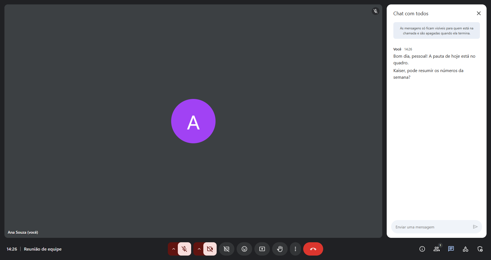
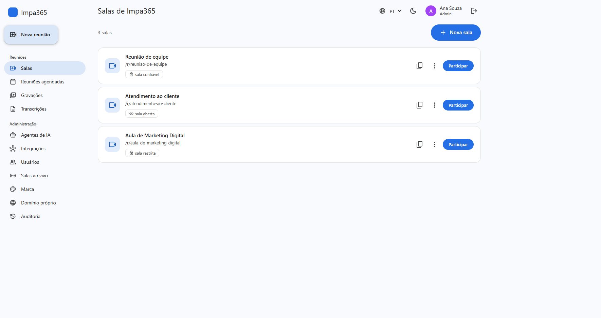
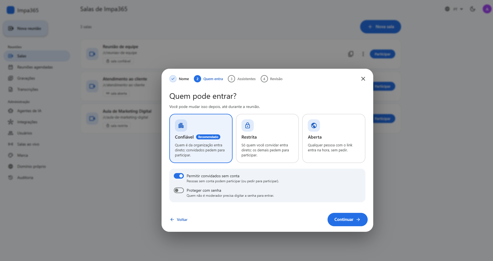
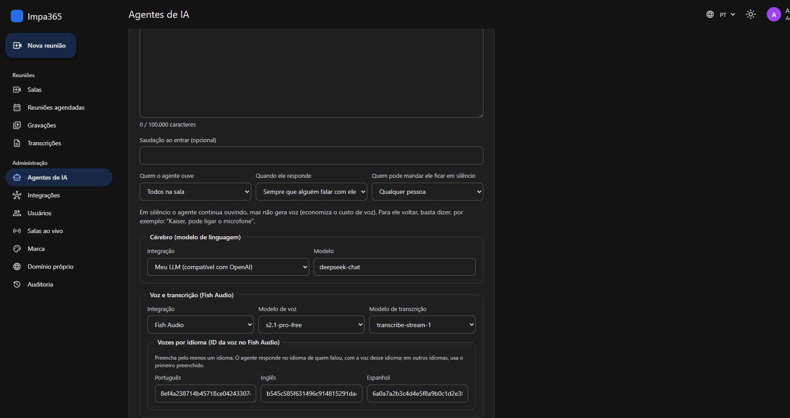
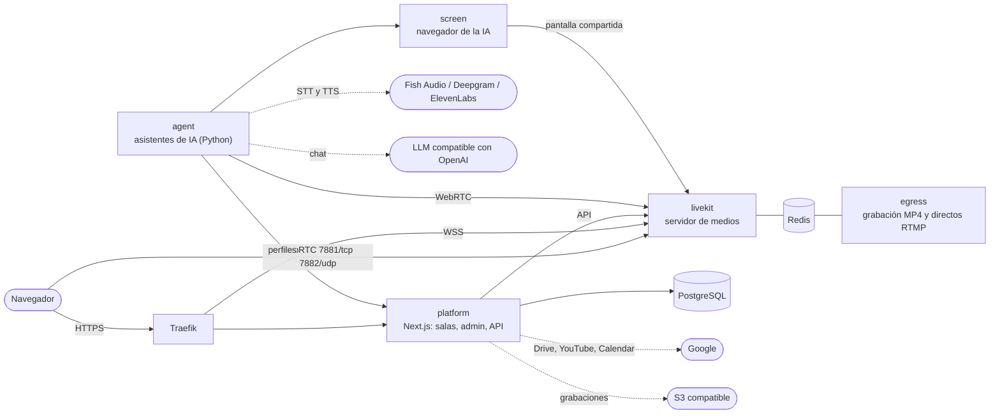

<div align="center">

# IMPA Meet

**Videoconferencia white-label con asistentes de IA que escuchan, hablan y presentan.**
Código abierto, autoalojada y lista para Docker Swarm y Portainer.

[](LICENSE)
[](https://hub.docker.com/r/impa365/impameet-platform)
[](https://hub.docker.com/r/impa365/impameet-platform)


[Funciones](#funciones) ·
[Instalación](#instalación-en-10-minutos) ·
[Arquitectura](#arquitectura) ·
[Desarrollo](#desarrollo) ·
[Apoya el proyecto](#apoya-el-proyecto)

[Português](README.md) · [English](README.en.md) · **Español**



</div>

---

**IMPA Meet** es una plataforma completa de reuniones por video que instalas en tu propio
servidor y entregas con tu marca. La diferencia está en los **asistentes de IA de voz**: entran
a la reunión como participantes, responden cuando los llaman por su nombre, hablan en el idioma
de quien preguntó, se pasan la palabra entre ellos e incluso comparten pantalla para presentar
páginas.

Creado y mantenido por **[Impa 365](https://impa365.com)**: automatización inteligente con IA
para empresas.

## Funciones

### Reuniones
- Interfaz al estilo **Google Meet**: cuadrícula y destacado, quién está hablando, barra de
  controles y paneles laterales.
- Pantalla de entrada con prueba de cámara y micrófono, **desenfoque y fondos virtuales**, y
  pantalla compartida.
- Chat, reacciones, levantar la mano, **subtítulos en vivo** y transcripción guardada.
- **Grabación** en MP4 (LiveKit Egress), **pizarra** colaborativa (Excalidraw), **encuestas** y
  **salas para grupos** (breakout rooms).
- **Moderación**: el organizador nombra moderadores durante la reunión (silenciar, expulsar,
  controles de la reunión).
- Programación con invitación por correo, archivo de calendario (`.ics`) y **Google
  Calendar**: cada persona conecta su propio calendario, la reunión entra allí con el enlace y
  Google invita a los invitados.

### Estudio y transmisiones en directo
- **Estudio al estilo StreamYard**: escenario y bastidores, subir y bajar personas del
  escenario, diseños (una persona, cuadrícula, destacado, pantalla + personas, pantalla
  completa), pantalla compartida en el escenario, nombres, **banners** (franja o rótulo en
  movimiento) y tu marca (colores y logo).
- **Transmisión en directo** a **YouTube** (conectando la cuenta: el directo se crea solo, sin
  copiar claves) y a **cualquier servidor RTMP** (Facebook, Instagram, Twitch, LinkedIn...), con
  **hasta 5 destinos a la vez**.
- La grabación y el directo de un estudio salen exactamente como se ve el escenario.

### Grabaciones en la nube
- Las grabaciones van solas a un **S3 o compatible** (Amazon S3, Cloudflare R2, Wasabi,
  Backblaze B2, MinIO) o a una carpeta de **Google Drive**, con o sin copia en el servidor.

### Asistentes de IA
- Hasta **4 asistentes por sala**, cada uno con su persona, base de conocimiento y voz. Con más
  de uno en la sala, cada asistente responde cuando dicen su nombre y le pasa la palabra al
  siguiente.
- **Cualquier LLM compatible con la API de OpenAI** (OpenAI, DeepSeek, OpenRouter, Groq,
  modelos locales...) y, para escuchar y hablar, **Fish Audio**, **Deepgram** o
  **ElevenLabs**, todos en tiempo real por WebSocket. La voz y la transcripción se eligen por
  separado: se pueden combinar, por ejemplo Deepgram escuchando y ElevenLabs hablando.
- **Una voz por idioma**: el asistente responde en portugués, inglés o español, según quién
  habló.
- Escucha a todos o solo a quien lo llame, se calla cuando se lo piden y **comparte pantalla**
  con su propio navegador, con cursor animado.
- Sin proveedor, modelo ni voz por defecto en el servidor: todo se elige en el panel, y las
  claves quedan cifradas.

### Control de acceso
- Sala **abierta**, **de confianza** o **restringida**, con lista de invitados.
- **Sala de espera**: el moderador aprueba a quien pide entrar.
- Contraseña opcional, invitados sin cuenta y permisos por sala (quién dibuja en la pizarra y
  quién crea encuestas).

### Plataforma SaaS white-label
- **Varias organizaciones** en la misma instalación, cada una con su marca, colores, logo e
  idioma por defecto.
- **Dominio propio por organización**, con certificado HTTPS automático (Traefik + Let's
  Encrypt).
- Panel de **administración** (usuarios, agentes, integraciones, salas en vivo, almacenamiento,
  transmisiones, seguridad, auditoría) y área de la **plataforma** para el super admin
  (resumen, organizaciones con plan y límites, correo y Google).
- Asistente guiado para crear salas (reunión o estudio).
- Interfaz en **portugués, inglés y español**, con tema claro y oscuro.

### Accesibilidad
- Lectores de pantalla (NVDA, JAWS, VoiceOver, TalkBack), atajos de teclado y avisos sonoros.
- **Entrada asistida por voz**: la plataforma pregunta el nombre, lo confirma con sí o no,
  informa el estado del micrófono y la cámara y solo entra después de una confirmación final.
- **Asistente de voz local** ("Star", con nombre configurable): enciende y apaga el micrófono y
  la cámara con órdenes simples, con reglas fijas y sin IA, y nunca graba el audio.

### Seguridad
- Secretos como **Docker Swarm secrets**: nunca en archivos, variables de entorno ni logs.
- Claves de proveedores, de almacenamiento y de transmisión, y accesos a Google, guardados con
  **AES-256-GCM**; nunca vuelven a la pantalla.
- Integraciones con Google por OAuth con PKCE, pidiendo solo el permiso que cada uso necesita.
- Verificación en dos pasos (app autenticadora, correo y passkeys).
- Redes overlay cifradas y aisladas por función.
- Contenedores de solo lectura y sin capabilities.
- Imágenes probadas y analizadas (Trivy) en cada versión.

## Pantallas

<table>
  <tr>
    <td></td>
    <td></td>
  </tr>
  <tr>
    <td align="center">Salas de la organización</td>
    <td align="center">Creación de sala guiada</td>
  </tr>
  <tr>
    <td colspan="2"></td>
  </tr>
  <tr>
    <td colspan="2" align="center">Agente de IA: LLM, transcripción y una voz por idioma (tema oscuro)</td>
  </tr>
</table>

## Instalación en 10 minutos

### Requisitos
- Servidor Linux con **Docker Swarm** (4 vCPU y 8 GB de RAM para empezar; la grabación, los
  directos y la pantalla compartida de la IA piden más).
- **Traefik** con Let's Encrypt en una red overlay externa, como en la mayoría de las
  instalaciones con Portainer.
- Dos registros DNS apuntando al servidor, por ejemplo `meet.tudominio.com` y
  `livekit.tudominio.com`.
- Puertos abiertos en el firewall: `80` y `443` (Traefik), `7881/tcp` y `7882/udp` (audio y
  video).

### 1. Crea los secretos

En el nodo manager del Swarm:

```bash
git clone https://github.com/impa365/impameet.git && cd impameet
bash deploy/scripts/prepare.sh
```

El script genera las claves de LiveKit, la contraseña de la base de datos, la clave de cifrado y
los tokens internos directamente en el Swarm. Ningún valor aparece en pantalla. Se puede volver
a ejecutar sin riesgo.

### 2. Sube la stack

**Con Portainer:** *Stacks → Add stack → Repository*

| Campo | Valor |
|---|---|
| Repository URL | `https://github.com/impa365/impameet` |
| Compose path | `deploy/stack.yml` |
| Environment variables | `PLATFORM_HOST`, `LIVEKIT_HOST` y `SERVER_PUBLIC_IP` (ver [`deploy/.env.example`](deploy/.env.example)) |

Ponle a la stack el nombre **`impameet`**.

**Por línea de comandos:**

```bash
cp deploy/.env.example deploy/.env   # completa los tres campos obligatorios
bash deploy/scripts/deploy.sh
```

### 3. Empieza a usarla

1. Abre `https://PLATFORM_HOST` y **crea tu cuenta**: eso crea la organización y el primer
   administrador.
2. En **Admin → Integraciones**, registra tu LLM (URL y clave compatibles con OpenAI) y tu
   clave de **Fish Audio**, **Deepgram** o **ElevenLabs** (puedes registrar más de una).
3. En **Admin → Agentes de IA**, elige el modelo, la transcripción y al menos una voz.
4. Haz clic en **Nueva sala** y marca los asistentes que van a participar.

La guía completa cubre dominios propios, correo, Google (Drive, YouTube y Calendar),
actualización, copias de seguridad y solución de problemas: **[docs/deploy.md](docs/deploy.md)**
(en portugués).

## Arquitectura



| Servicio | Carpeta | Tecnología |
|---|---|---|
| `platform` | [`apps/platform`](apps/platform) | Next.js 15, React 18, LiveKit Components, PostgreSQL |
| `agent` | [`apps/agent`](apps/agent) | Python 3.12, LiveKit Agents, Fish Audio / Deepgram / ElevenLabs, LLM compatible con OpenAI |
| `screen` | [`apps/screen`](apps/screen) | Python 3.12, Playwright (Chromium headless), LiveKit RTC |
| `livekit`, `egress`, `redis`, `postgres` | [`deploy/stack.yml`](deploy/stack.yml) | Imágenes oficiales, versiones fijadas |

Las imágenes listas están en **Docker Hub**:
[`impa365/impameet-platform`](https://hub.docker.com/r/impa365/impameet-platform),
[`impa365/impameet-agent`](https://hub.docker.com/r/impa365/impameet-agent) y
[`impa365/impameet-screen`](https://hub.docker.com/r/impa365/impameet-screen). Cada versión se publica con
su número (por ejemplo `1.0.0`) y como `latest`.

## Desarrollo

```bash
# Plataforma (Node 22)
cd apps/platform
npm ci
npm run dev                 # http://localhost:3000
npm run lint && npm run typecheck && npm test
npm run test:integration    # necesita TEST_DATABASE_URL (PostgreSQL)

# Agente y servicio de pantalla (Python 3.12 + uv)
cd apps/agent               # o apps/screen
uv sync
uv run pytest               # cobertura mínima del 90%
uv run ruff check src tests && uv run mypy && uv run bandit -q -r src
```

Cada `Dockerfile` tiene una etapa `test` que ejecuta la batería completa dentro de la imagen:
`docker build --target test apps/<app>`.

Para publicar una versión en Docker Hub (con Docker Desktop conectado a la cuenta), ejecuta
`bash deploy/scripts/release.sh 1.2.0`. El script prueba, analiza y solo publica si todo pasa.

Para contribuir, mira [CONTRIBUTING.md](CONTRIBUTING.md). Para reportar una falla de seguridad,
sigue [SECURITY.md](SECURITY.md); nunca uses una issue pública.

## Licencia y créditos

Distribuido bajo la **[Licencia Apache 2.0](LICENSE)**. Puedes usar, modificar, distribuir e
incluso vender, **siempre que mantengas los créditos**: toda copia o versión modificada debe
incluir el archivo [`NOTICE`](NOTICE), que acredita a **Impa 365** como creadora del proyecto,
además de los avisos de copyright del código.

Los nombres "Impa 365", "IMPA365" e "IMPA Meet" y sus logos no forman parte de la licencia: un
producto derivado debe tener otro nombre.

## Apoya el proyecto

IMPA Meet es gratuito y abierto. Si te fue útil a ti o a tu empresa, considera apoyar el
desarrollo con un Pix (el pago instantáneo de Brasil) de cualquier valor. 💙

<table>
  <tr>
    <td align="center" width="240">
      <br>
      <sub>Escanéalo con la app de tu banco</sub>
    </td>
    <td>
      <strong>Clave Pix (correo):</strong> <code>pix1@impa365.com</code><br><br>
      <strong>Pix copia y pega:</strong>
      <pre>00020126380014br.gov.bcb.pix0116pix1@impa365.com5204000053039865802BR5908IMPA 3656006BRASIL62120508IMPAMEET63043764</pre>
      Después, solo escribe el valor en la app del banco.
    </td>
  </tr>
</table>

También ayuda mucho darle una ⭐ al repositorio y compartirlo con quien lo necesite.

---

<div align="center">

Hecho con dedicación por **[Impa 365](https://impa365.com)**
Automatización inteligente con IA para empresas · [contato@impa365.com](mailto:contato@impa365.com)

</div>
