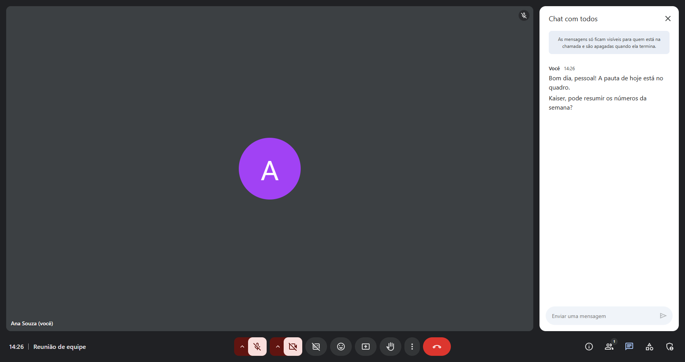
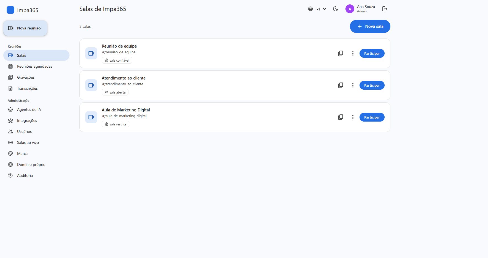
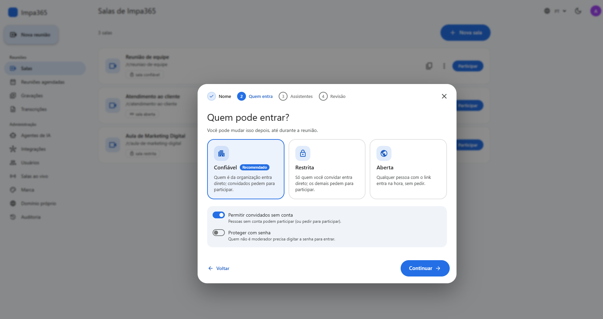
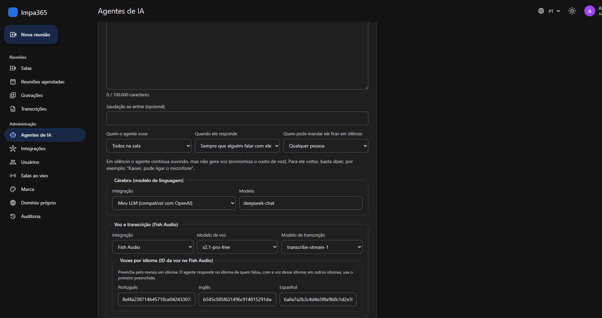
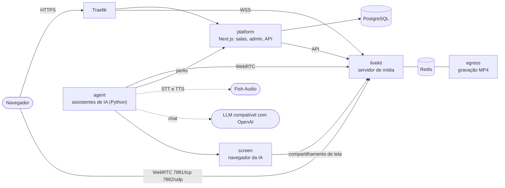

<div align="center">

# IMPA Meet

**Videoconferência white-label com assistentes de IA que falam, ouvem e apresentam.**
Open source, auto-hospedada e pronta para Docker Swarm e Portainer.

[](LICENSE)
[](https://github.com/impa365/impameet/actions/workflows/ci.yml)
[](https://github.com/impa365/impameet/pkgs/container/impameet-platform)


[Recursos](#recursos) ·
[Instalação](#instalação-em-10-minutos) ·
[Arquitetura](#arquitetura) ·
[Desenvolvimento](#desenvolvimento) ·
[Apoie o projeto](#apoie-o-projeto) ·
[English](README.en.md)



</div>

---

O **IMPA Meet** é uma plataforma completa de reuniões por vídeo que você instala no seu
próprio servidor e entrega com a sua marca. A diferença está nos **assistentes de IA de voz**:
eles entram na reunião como participantes, respondem pelo nome, falam no idioma de quem
perguntou, passam a vez uns para os outros e até compartilham a tela para apresentar páginas.

Criado e mantido pela **[Impa 365](https://impa365.com)**: automação inteligente com IA para
empresas.

## Recursos

### Reuniões
- Interface no estilo **Google Meet**: grade e destaque, quem está falando, barra de controles
  e painéis laterais.
- Tela de entrada com teste de câmera e microfone, **desfoque e fundos virtuais** e
  compartilhamento de tela.
- Chat, reações, levantar a mão, **legendas ao vivo** e transcrição salva.
- **Gravação** em MP4 (LiveKit Egress), **quadro branco** colaborativo (Excalidraw),
  **enquetes** e **salas paralelas** (breakout rooms).
- Agendamento com convite por e-mail e arquivo de calendário (`.ics`).

### Assistentes de IA
- Até **4 assistentes por sala**, cada um com a sua persona, base de conhecimento e voz.
  Com mais de um na sala, cada assistente responde quando chamam o nome dele e passa a vez
  para o próximo.
- **Qualquer LLM compatível com a API da OpenAI** (OpenAI, DeepSeek, OpenRouter, Groq,
  modelos locais...) e **Fish Audio** para transcrição e voz.
- **Uma voz por idioma**: o assistente responde em português, inglês ou espanhol, conforme quem
  falou.
- Ouve todos ou só quem o chamar, fica em silêncio quando pedem e **compartilha a tela** com
  um navegador próprio, com cursor animado.
- Sem provedor, modelo ou voz padrão no servidor: tudo é escolhido no painel, e as chaves
  ficam criptografadas.

### Controle de acesso
- Sala **aberta**, **confiável** ou **restrita**, com lista de convidados.
- **Sala de espera**: o moderador aprova quem pede para entrar.
- Senha opcional, convidados sem conta e permissões por sala (quem desenha no quadro e quem
  cria enquetes).

### Plataforma SaaS white-label
- **Várias organizações** na mesma instalação, cada uma com marca, cores, logo e idioma padrão.
- **Domínio próprio por organização**, com certificado HTTPS automático (Traefik + Let's
  Encrypt).
- Painel de **administração** (usuários, agentes, integrações, salas ao vivo, auditoria) e de
  **super admin**.
- Assistente guiado para criar salas.
- Interface em **português, inglês e espanhol**, com tema claro e escuro.
- **Acessível**: leitores de tela, atalhos de teclado e avisos sonoros.

### Segurança
- Segredos como **Docker Swarm secrets**: nunca em arquivo, variável de ambiente ou log.
- Chaves dos provedores salvas no banco com **AES-256-GCM**.
- Redes overlay criptografadas e isoladas por função.
- Containers somente leitura e sem capabilities.
- Imagens testadas e varridas (Trivy) a cada versão.

## Telas

<table>
  <tr>
    <td></td>
    <td></td>
  </tr>
  <tr>
    <td align="center">Salas da organização</td>
    <td align="center">Criação de sala guiada</td>
  </tr>
  <tr>
    <td colspan="2"></td>
  </tr>
  <tr>
    <td colspan="2" align="center">Agente de IA: LLM, transcrição e uma voz por idioma (tema escuro)</td>
  </tr>
</table>

## Instalação em 10 minutos

### Requisitos
- Servidor Linux com **Docker Swarm** (4 vCPU e 8 GB de RAM para começar; gravação e
  compartilhamento de tela pela IA pedem mais).
- **Traefik** com Let's Encrypt numa rede overlay externa, como na maioria das instalações
  com Portainer.
- Dois registros DNS apontando para o servidor, por exemplo `meet.seudominio.com` e
  `livekit.seudominio.com`.
- Portas liberadas no firewall: `80` e `443` (Traefik), `7881/tcp` e `7882/udp` (áudio e
  vídeo).

### 1. Crie os segredos

No nó manager do Swarm:

```bash
git clone https://github.com/impa365/impameet.git && cd impameet
bash deploy/scripts/prepare.sh
```

O script gera as chaves do LiveKit, a senha do banco, a chave de criptografia e os tokens
internos direto no Swarm. Nenhum valor aparece na tela. Ele pode ser rodado de novo sem
risco.

### 2. Suba a stack

**Pelo Portainer:** *Stacks → Add stack → Repository*

| Campo | Valor |
|---|---|
| Repository URL | `https://github.com/impa365/impameet` |
| Compose path | `deploy/stack.yml` |
| Environment variables | `PLATFORM_HOST`, `LIVEKIT_HOST` e `SERVER_PUBLIC_IP` (veja [`deploy/.env.example`](deploy/.env.example)) |

Dê à stack o nome **`impameet`**.

**Pela linha de comando:**

```bash
cp deploy/.env.example deploy/.env   # preencha os três campos obrigatórios
bash deploy/scripts/deploy.sh
```

### 3. Comece a usar

1. Abra `https://PLATFORM_HOST` e **crie a sua conta**: ela cria a organização e o primeiro
   administrador.
2. Em **Admin → Integrações**, cadastre o seu LLM (URL e chave compatíveis com OpenAI) e a sua
   chave do **Fish Audio**.
3. Em **Admin → Agentes de IA**, escolha o modelo, a transcrição e pelo menos uma voz.
4. Clique em **Nova sala** e marque os assistentes que vão participar.

O guia completo cobre domínios próprios, e-mail, atualização, backup e solução de problemas:
**[docs/deploy.md](docs/deploy.md)**.

## Arquitetura



| Serviço | Pasta | Tecnologia |
|---|---|---|
| `platform` | [`apps/platform`](apps/platform) | Next.js 15, React 18, LiveKit Components, PostgreSQL |
| `agent` | [`apps/agent`](apps/agent) | Python 3.12, LiveKit Agents, Fish Audio, LLM compatível com OpenAI |
| `screen` | [`apps/screen`](apps/screen) | Python 3.12, Playwright (Chromium headless), LiveKit RTC |
| `livekit`, `egress`, `redis`, `postgres` | [`deploy/stack.yml`](deploy/stack.yml) | Imagens oficiais, versões fixadas |

As imagens ficam no GitHub Container Registry:
`ghcr.io/impa365/impameet-platform`, `-agent` e `-screen`. A tag `latest` acompanha a branch
`main`, e as versões (`v1.2.3`) geram `1.2.3`, `1.2` e `1`.

## Desenvolvimento

```bash
# Plataforma (Node 22)
cd apps/platform
npm ci
npm run dev                 # http://localhost:3000
npm run lint && npm run typecheck && npm test
npm run test:integration    # precisa de TEST_DATABASE_URL (PostgreSQL)

# Agente e serviço de tela (Python 3.12 + uv)
cd apps/agent               # ou apps/screen
uv sync
uv run pytest               # cobertura mínima de 90%
uv run ruff check src tests && uv run mypy && uv run bandit -q -r src
```

Cada `Dockerfile` tem um estágio `test` que roda a bateria completa dentro da imagem, a mesma
usada pela CI: `docker build --target test apps/<app>`.

Para contribuir, veja o [CONTRIBUTING.md](CONTRIBUTING.md). Para relatar uma falha de
segurança, siga o [SECURITY.md](SECURITY.md); nunca use uma issue pública.

## Licença e créditos

Distribuído sob a **[Licença Apache 2.0](LICENSE)**. Você pode usar, modificar, distribuir e
até vender, **desde que mantenha os créditos**: toda cópia ou versão modificada precisa
incluir o arquivo [`NOTICE`](NOTICE), que credita a **Impa 365** como criadora do projeto,
além dos avisos de copyright do código.

Os nomes "Impa 365", "IMPA365" e "IMPA Meet" e os seus logos não fazem parte da licença: um
produto derivado precisa ter outro nome.

## Apoie o projeto

O IMPA Meet é gratuito e aberto. Se ele foi útil para você ou para a sua empresa, considere
apoiar o desenvolvimento com um Pix de qualquer valor. 💙

<table>
  <tr>
    <td align="center" width="240">
      <br>
      <sub>Aponte a câmera do app do seu banco</sub>
    </td>
    <td>
      <strong>Chave Pix (e-mail):</strong> <code>pix1@impa365.com</code><br><br>
      <strong>Pix copia e cola:</strong>
      <pre>00020126380014br.gov.bcb.pix0116pix1@impa365.com5204000053039865802BR5908IMPA 3656006BRASIL62120508IMPAMEET63043764</pre>
      Em seguida, é só digitar o valor no app do banco.
    </td>
  </tr>
</table>

Também ajuda muito dar uma ⭐ no repositório e compartilhar com quem precisa.

---

<div align="center">

Feito com dedicação pela **[Impa 365](https://impa365.com)**
Automação inteligente com IA para empresas · [contato@impa365.com](mailto:contato@impa365.com)

</div>
